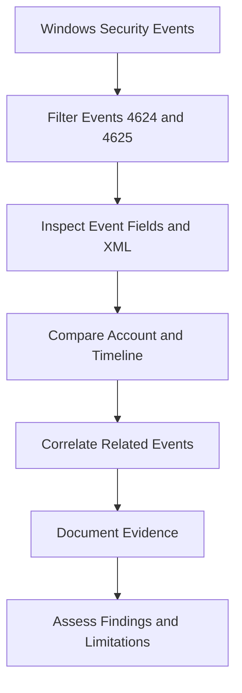
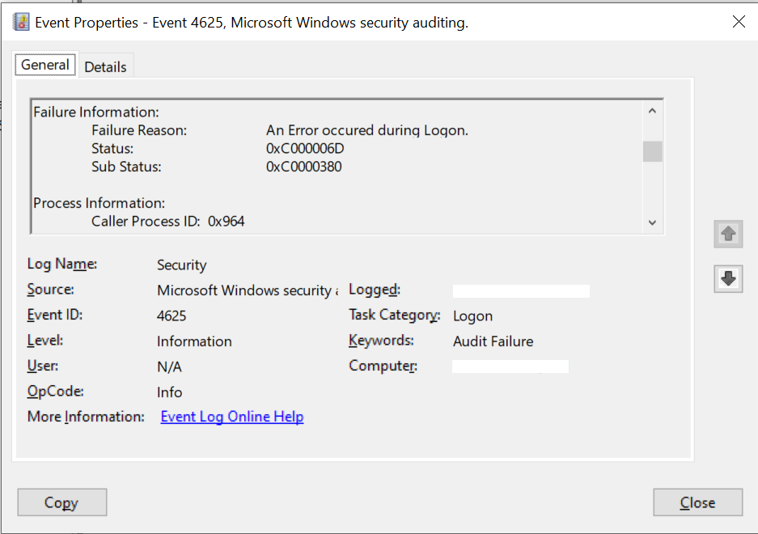

# 🛡️ Windows Authentication Log Investigator

**Windows Security Logs | Authentication Analysis | SOC Investigation**


## 📌 Project Overview

This project demonstrates a structured investigation of Windows authentication events using Windows Event Viewer. It focuses on analyzing failed logons, examining successful workstation unlock activity, correlating event timelines, and documenting evidence using a defensive SOC investigation workflow.

## 🎯 Objectives

- Analyze Windows Security Event IDs 4624 and 4625.
- Interpret logon types and authentication-related fields.
- Compare repeated failed logons and subsequent successful events.
- Validate event details using XML Event View.
- Document observations, uncertainty, and investigation limitations.

## 🧰 Tools & Technologies

| Tool | Purpose |
|---|---|
| Windows Event Viewer | Examine Windows Security events |
| Windows Security Logs | Investigate authentication activity |
| XML Event View | Cross-check event fields |
| Notepad | Document investigation findings |
| GitHub | Publish project documentation |

## 🔍 Investigation Workflow



## 📊 Investigation Findings

- Examined Event ID 4624 events with Logon Type 7, associated with workstation unlock activity.
- Investigated Event ID 4625 events with Logon Type 2, associated with interactive logon attempts.
- Observed repeated failures involving the same account and source-address category.
- Compared caller-process information across the reviewed failed events.
- Correlated the failed-event cluster with a subsequent successful workstation unlock.
- Cross-checked status and substatus values using XML Event View.

## 🚨 Security Assessment

**Assessment: Inconclusive**

The reviewed events showed repeated failed interactive logons followed by a successful workstation unlock for the same account. The available evidence does not independently establish whether the failures were malicious or benign.

A successful unlock after failed attempts does not, by itself, prove that an attacker gained access. Additional context and corroborating evidence would be required for stronger attribution.

## 📁 Project Structure

```text
windows-auth-log-investigator/
├── README.md
├── investigation-001.md
├── failed-logon-events.png
├── analyze_auth_logs.py
├── sample_auth_events.csv
├── reports/
│   └── authentication_analysis_report.txt
└── screenshots/
    └── python-analysis-output.png
```

The project includes investigation documentation, sanitized Windows event evidence, a Python authentication-log analyzer, simulated sample data, and a generated analysis report.

## 🚀 Planned Improvements

- Add reproducible test cases for normal logons, repeated failures, and malformed or missing input files.
- Improve event-timeline reporting to make authentication activity easier to review.
- Validate Windows event interpretations against official Microsoft documentation.
- Expand detection logic carefully and document its limitations to avoid treating alerts as proof of malicious activity.

## 🔒 Disclaimer

This project is for defensive cybersecurity education using logs from my own Windows environment. Findings are limited to the evidence examined. Sensitive information and raw personal logs should not be published.

## 📷 Investigation Evidence

The following sanitized screenshot shows a Windows Security Event ID 4625 (failed logon) examined during this investigation.



The screenshot hides the computer name and exact event timestamp while retaining the relevant technical fields.

## 🐍 Python Log Analyzer

A Python script that reads simulated Windows authentication events from a CSV file and summarizes login activity.

### ✨ Features
- Reads event data from `sample_auth_events.csv`.
- Counts failed logons (Event ID 4625) and successful logons (Event ID 4624).
- Groups failed logons by source address.
- Flags sources with three or more failed logons for further review.
- Handles missing files and basic data-format errors.
- Automatically generates a text report containing authentication counts, source-based failure totals, and an analyst assessment.

### ▶️ How to Run
1. Install Python 3.
2. Keep `analyze_auth_logs.py` and `sample_auth_events.csv` in the same folder.
3. Open Command Prompt in that folder.
4. Run `py analyze_auth_logs.py`.
5. The generated report is saved as `reports/authentication_analysis_report.txt`.

### ⚠️ Important Note
The current version uses simulated sample data. A repeated-failure alert is a prompt for investigation, not proof of malicious activity.
