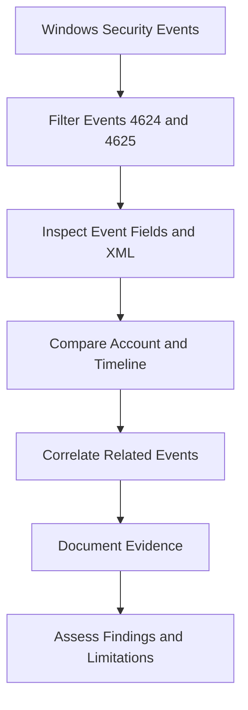

# 🛡️ Windows Authentication Log Investigator

**Windows Security Logs | Authentication Analysis | SOC Investigation**


## 📌 Project Overview

This project demonstrates a structured investigation of Windows authentication events using Windows Event Viewer. It focuses on analyzing failed logons, examining successful workstation unlock activity, correlating event timelines, and documenting evidence using a defensive SOC investigation workflow.

## 🎯 Objectives

- Analyze Windows Security Event IDs 4624 and 4625.
- Interpret logon types and authentication-related fields.
- Compare repeated failed logons and subsequent successful events.
- Validate event details using XML Event View.
- Document observations, uncertainty, and investigation limitations.

## 🧰 Tools & Technologies

| Tool | Purpose |
|---|---|
| Windows Event Viewer | Examine Windows Security events |
| Windows Security Logs | Investigate authentication activity |
| XML Event View | Cross-check event fields |
| Notepad | Document investigation findings |
| GitHub | Publish project documentation |

## 🔍 Investigation Workflow



## 📊 Investigation Findings

- Examined Event ID 4624 events with Logon Type 7, associated with workstation unlock activity.
- Investigated Event ID 4625 events with Logon Type 2, associated with interactive logon attempts.
- Observed repeated failures involving the same account and source-address category.
- Compared caller-process information across the reviewed failed events.
- Correlated the failed-event cluster with a subsequent successful workstation unlock.
- Cross-checked status and substatus values using XML Event View.

## 🚨 Security Assessment

**Assessment: Inconclusive**

The reviewed events showed repeated failed interactive logons followed by a successful workstation unlock for the same account. The available evidence does not independently establish whether the failures were malicious or benign.

A successful unlock after failed attempts does not, by itself, prove that an attacker gained access. Additional context and corroborating evidence would be required for stronger attribution.

## 📁 Project Structure

```text
windows-auth-log-investigator/
├── README.md
├── reports/
│   └── investigation-001.txt
├── evidence/
└── screenshots/
```

## 🚀 Planned Improvements

- Develop a Python script to analyze sanitized Windows event data.
- Add a structured event timeline and reproducible test cases.
- Develop and validate detection logic for repeated failed logons.
- Add sanitized screenshots and supporting evidence.
- Validate event-code interpretations against official documentation.

## 🔒 Disclaimer

This project is for defensive cybersecurity education using logs from my own Windows environment. Findings are limited to the evidence examined. Sensitive information and raw personal logs should not be published.

---

*Building practical blue-team skills through evidence-based investigation.*
